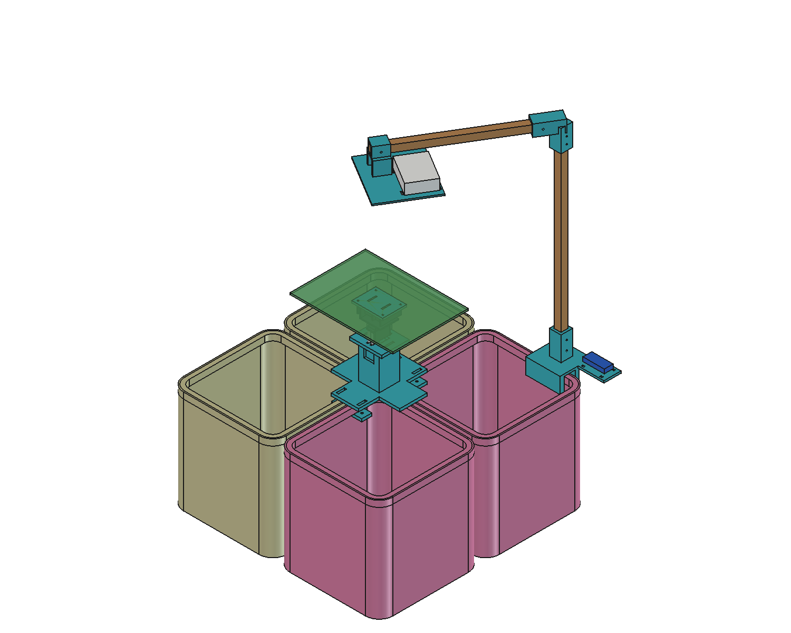

# EcoSort Smart Bin

Camera V2 observes a stationary tray. The existing CLIP classifier selects one
of four routes, and a PCA9685 drives two MG996R servos in the RB0051 pan/tilt kit.
The assembly is a **fit-test prototype** for the four rounded baskets in the
project photographs. Bin, case and bracket measurements are still required.



## Start here

- [Step-by-step assembly, measurements and shopping list](docs/assembly.md)
- [Pi setup, wiring, calibration and running](docs/pi_setup.md)
- [What was verified without the Raspberry Pi](docs/verification.md)
- [Separate printable STLs](hardware/design/output/stl/)
- [Complete FreeCAD assembly](hardware/design/output/complete_assembly.FCStd)
- [Complete STEP assembly](hardware/design/output/complete_assembly.step)
- [Motor mechanism only](hardware/design/output/motor_assembly.FCStd)
- [Individual editable STEP parts](hardware/design/output/step/)

Print **09_rim_and_timber_fit_coupon.stl first**, not the whole assembly. The
assembly contains purchased/reference hardware and bins that must not be printed.
Print quantities are in the assembly guide. The short camera ribbon is retained:
the existing cased Pi and Camera V2 sit together on the overhead open carrier.
The driver stays on the rear clip with longer low-voltage wires to the Pi.

## Repository layout

```text
live_smart_bin.py           Active camera/CLIP/sorting application
servo_control.py            Physical servo calibration tool
check_camera.py             Read-only Pi camera diagnostic
setup_raspberry_pi.sh        Pi OS dependency and I2C setup
fix_openblas.sh              Optional Pi-only BLAS repair utility
requirements.txt            Active runtime dependencies
hardware/design/
  parameters.json           Provisional mechanical dimensions
  build.py                  FreeCAD geometry and validation
  Build.FCMacro             Regenerate in FreeCAD
  output/                   STLs, STEPs, assembly and checks
docs/                       Assembly, Pi setup and verification guides
tests/                      Offline regression and STL integrity checks
```

Existing root command names are retained so Pi launch commands still work.
Superseded CAD versions are recoverable in Git history and an ignored local
archive; they are not required to rebuild this design. Personal photos, model
weights, datasets, virtual environments and CAD backup files are not published.

## Check on a computer without the Pi

With the runtime dependencies installed in your Python environment:

```sh
python -m unittest discover -s tests -v
python scripts/verify.py
python live_smart_bin.py --help
bash -n setup_raspberry_pi.sh fix_openblas.sh
```

Tests use fake devices and synthetic frames. They do not open a camera, send
servo commands, download weights or evaluate classification accuracy. Camera
enumeration on a Mac reports unavailable; it is not evidence of a wiring fault.

## Regenerate the CAD

Open `hardware/design/Build.FCMacro` in FreeCAD and run it. It reads
`parameters.json` and regenerates the checked parts and complete assembly.
Alternatively run `build.py --headless` using FreeCAD's Python interpreter for
geometry exports; run the macro for colours, saved view and preview image.
FreeCAD's bundled `Part`, `MeshPart` and `Mesh` libraries are sufficient; no
third-party CAD or downloaded component models are required.

The current four categories are paper/cardboard, plastic/polythene, organic,
and glass/metal/residual. These are project routes, not a claim that the system
implements every Colombo Municipal Council waste stream. No hazardous-waste
classifier or physical hazardous-waste handling has been validated. The existing
zero-shot CLIP model is unchanged; moving the camera requires real-image checks.
The unrelated, unused MobileNet training experiment has been archived locally
and is also recoverable from Git history.
