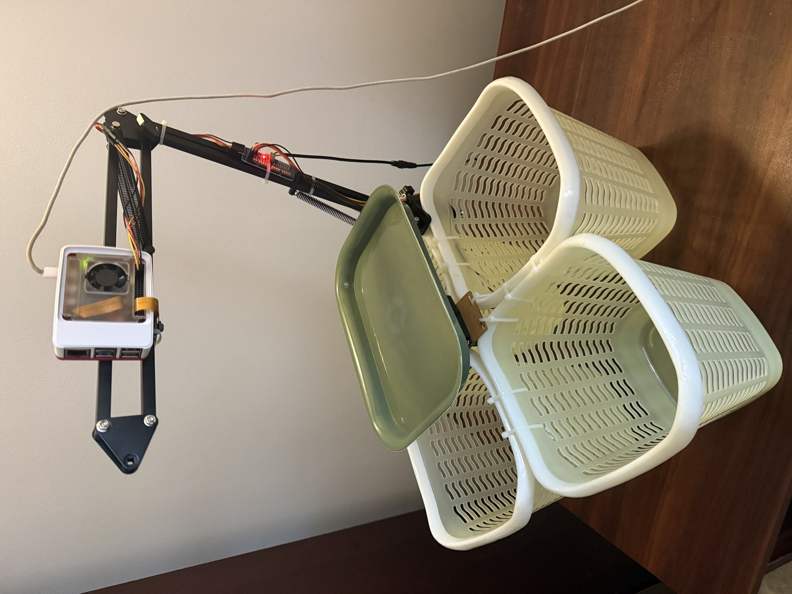
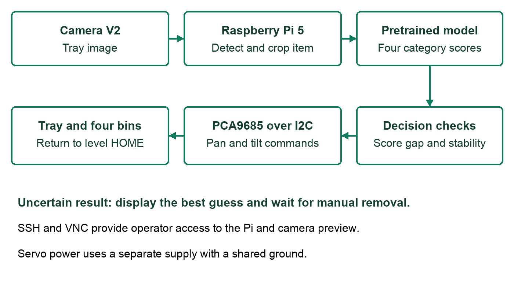
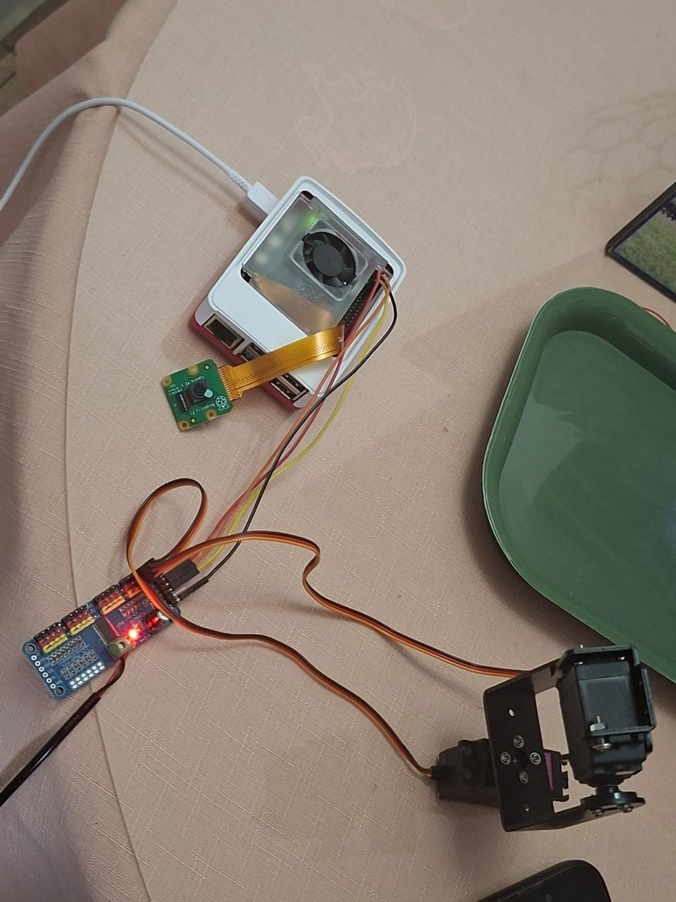
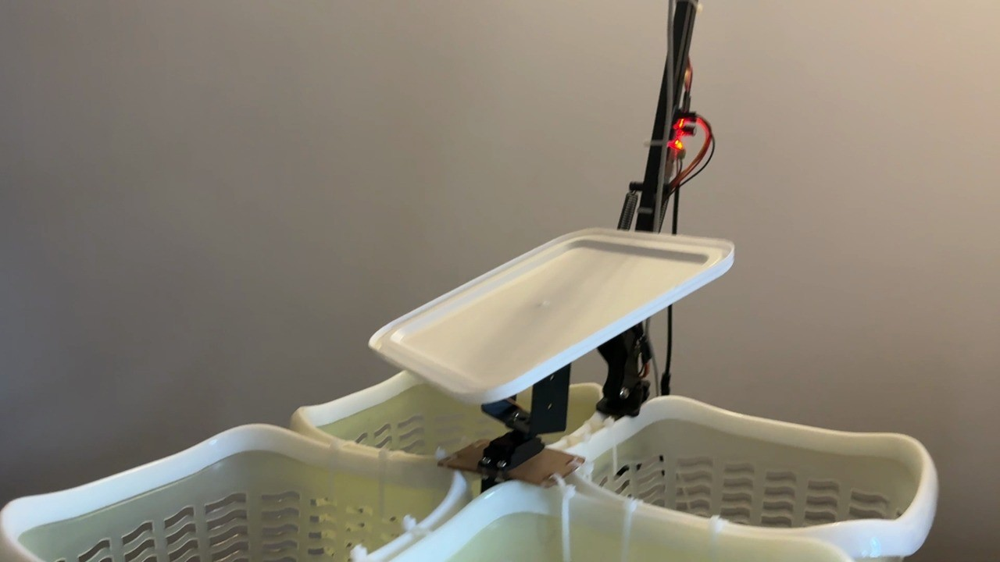
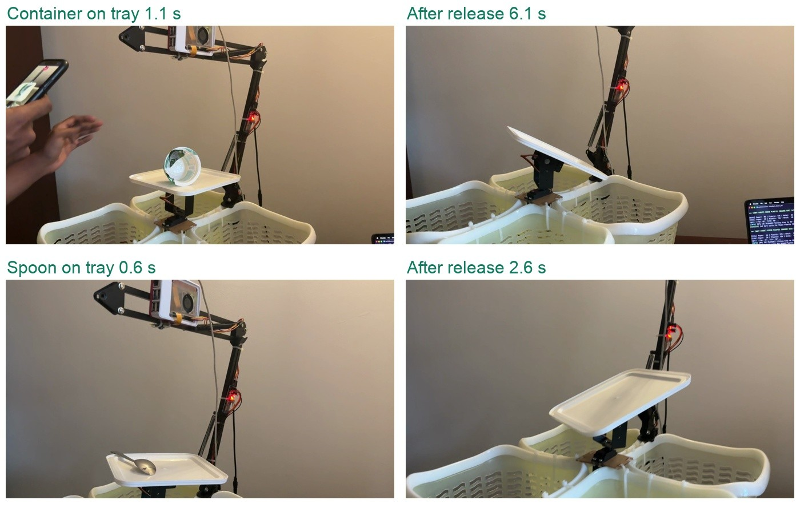
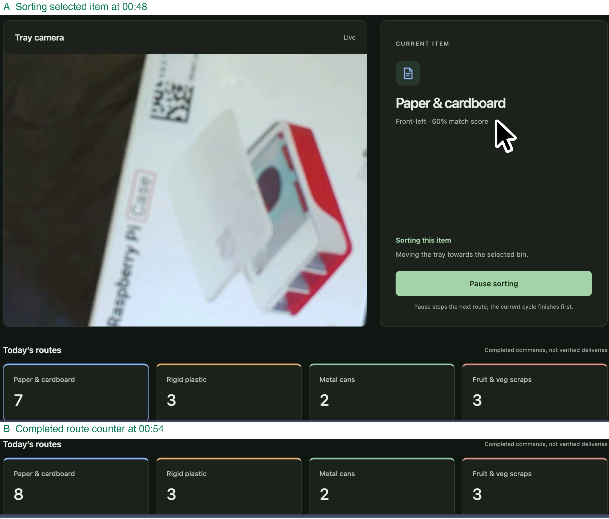

# EcoSort Smart Bin ♻️🤖

[](https://www.python.org/)
[](https://www.raspberrypi.com/)
[](https://huggingface.co/)
[](https://www.adafruit.com/product/815)
[](LICENSE)

> **An autonomous, vision-based 4-way waste sorting system combining zero-shot edge AI classification, a 2-axis servo pan-tilt mechanism, automated tray presence detection, and a real-time web telemetry dashboard.**

Developed for the Term 1 Project in the **Department of Electronic and Telecommunication Engineering** by **Team EN12**.

---

<p align="center">
  
  <br>
  <em>Figure 1: Fully assembled EcoSort prototype showing 4 collection bins, central pan-tilt mechanism, stationary scanning tray, and overhead Raspberry Pi 5 with Camera Module V2.</em>
</p>

<p align="center">
  <a href="https://www.youtube.com/watch?v=g44knE0W17k"><b>▶️ Watch Demonstration Video on YouTube</b></a> &nbsp;|&nbsp;
  <a href="#quickstart"><b>⚡ Quickstart</b></a> &nbsp;|&nbsp;
  <a href="#system-architecture"><b>📐 Architecture</b></a> &nbsp;|&nbsp;
  <a href="#web-dashboard--telemetry"><b>🌐 Web Dashboard</b></a> &nbsp;|&nbsp;
  <a href="#codebase-structure"><b>📦 Code Structure</b></a>
</p>

---

## 🌟 Key Highlights

- **🧠 Edge Multi-Modal Zero-Shot Classification**: Uses **OpenAI CLIP (ViT-B/32)** or **Google SigLIP 2** to recognize waste items zero-shot from natural language descriptions without requiring millions of custom training images.
- **🦾 Smooth Quintic S-Curve Motion Profiling**: Implements a 5th-order quintic polynomial trajectory planner (`motion_steps`) with zero start/end acceleration to eliminate gear jerking and minimize physical servo vibration.
- **🎯 Temporal Ensemble & Rejection Gating**: Evaluates items across sliding multi-frame windows with strict confidence thresholds and top-two class margin gates, preventing false triggers and keeping unsupported items safely on the tray.
- **🌐 Real-Time Web Telemetry & Dashboard**: Browser dashboard providing live MJPEG camera streaming, match confidence bars, four-bin sorting counters, estimated recyclable/organic percentages, and pause/resume controls.
- **🔄 Human-in-the-Loop Continuous Learning**: Captures and stores high-resolution crops of every sorted item in an embedded SQLite review store. Operators can inspect images, verify or correct labels, and export ZIP bundles for model fine-tuning.
- **💻 Full Hardware Simulation Mode**: Run the entire system, classifier, and web dashboard offline on macOS, Linux, or Windows without physical motors or a Raspberry Pi.

---

## 📐 System Architecture

EcoSort operates in a closed loop: Camera Module V2 captures frames of a stationary tray, background subtraction detects item placement, a tight letterboxed crop is fed into the vision-language model, and the PCA9685 driver coordinates the 2-axis pan-tilt tray to slide the item into its designated bin.

<p align="center">
  
  <br>
  <em>Figure 2: EcoSort end-to-end hardware and software architecture diagram.</em>
</p>
---

## 🗑️ 2x2 Grid Sorting Matrix

The system features four colored collection baskets arranged symmetrically in a 2x2 grid around a center-mounted pan-tilt mechanism:

| Bin | Category | Color | Quadrant | Pan Angle | Tilt Dump Angle | Mode |
|:---:|:---|:---:|:---:|:---:|:---:|:---:|
| **1** | **Paper & Cardboard** | Blue | Front-Left (Q2) | **135°** | **35°** | Forward Dump |
| **2** | **Rigid Plastic Containers** | Orange | Front-Right (Q1) | **45°** | **35°** | Forward Dump |
| **3** | **Metal Cans** | Green | Rear-Left (Q3) | **45°** | **145°** | Backward Dump |
| **4** | **Fruit & Vegetable Scraps** | Red | Rear-Right (Q4) | **135°** | **145°** | Backward Dump |

> **Calibrated HOME**: **Pan 90° / Tilt 125°** (Saved in `servo_calibration.json`).  
> **Pan Holding Release**: Pan servo PWM signal is released at HOME and during tipping to eliminate holding hum and prevent motor overheating while tilt torque remains active.

---

## 🦾 Hardware Configuration & BOM

<p align="center">
  
  &nbsp;&nbsp;
  
  <br>
  <em>Figure 3: Left: Cooled Raspberry Pi 5 case, Camera Module V2, PCA9685 driver, and wiring. Right: Pan-tilt center bracket and tray clearance.</em>
</p>

### Bill of Materials (BOM)

| Component | Model / Specification | Purpose |
|:---|:---|:---|
| **Single Board Computer** | Raspberry Pi 5 (4GB / 8GB RAM) | Core processing, CLIP inference, web server |
| **Camera Sensor** | Raspberry Pi Camera Module V2 (Sony IMX219 8MP) | Overhead waste observation (640x480 @ 15fps) |
| **PWM Driver** | Adafruit / Waveshare PCA9685 (16-Channel 12-Bit I2C) | Dual-servo PWM pulse generation (`0x40`) |
| **Servos** | 2x TowerPro MG996R High-Torque Metal Gear Servos | Pan axis (azimuth) & Tilt axis (pitch) actuation |
| **Mechanism** | Aluminum 2-DOF Pan-Tilt Bracket Kit | Two-axis mechanical gimbal mount |
| **Tray & Support** | Custom lightweight matte scanning tray & center support | Object staging and tilt-dump delivery |
| **Bins** | 4x Plastic collection baskets (Blue, Orange, Green, Red) | Categorized waste receptacles |
| **Power Supply** | Dual-rail configuration: 5V 5A USB-C (Pi) + 5V-6V 3A (Servos) | Prevents motor voltage drops from resetting the Pi |

---

## 🎬 Real-World Sorting Demonstrations

<p align="center">
  
  <br>
  <em>Figure 4: Real-world sorting demonstrations: Top: Rigid plastic container sorted to Front-Right. Bottom: Metal beverage can sorted to Rear-Left.</em>
</p>

🎥 **Watch the full operation in action on YouTube:** [https://www.youtube.com/watch?v=g44knE0W17k](https://www.youtube.com/watch?v=g44knE0W17k)

---

## 🌐 Web Dashboard & Telemetry

EcoSort includes a built-in web dashboard accessible from any browser on the local network (no display or monitor required on the Pi).

<p align="center">
  
  <br>
  <em>Figure 5: Live web dashboard displaying real-time MJPEG camera stream, relative match scores, bin tally counters, and recyclable/compostable material breakdown.</em>
</p>

<p align="center">
  
  <br>
  <em>Figure 6: Built-in image review interface allowing operators to confirm or correct predictions and export reviewed datasets.</em>
</p>

### Dashboard Features
- **Live Stream**: Low-latency MJPEG video with bounding box overlays.
- **Match Confidence Meters**: Live probability breakdown for Paper, Plastic, Metal, Food, and Unknown classes.
- **Real-Time Bin Counters**: Incrementing counts for each of the four waste streams.
- **System Controls**: One-click Pause/Resume, Force Scan, and Empty Tray Recalibration.
- **Human-in-the-Loop Review Store**: View past sorted items, verify or update ground-truth labels, and download export ZIP bundles.

---

## 📦 Codebase Structure

The project has been organized into a modular Python package (`ecosort`) with dedicated submodules:

```text
EcoSort_Smart_Bin/
├── assets/                     # Architecture diagrams, prototype photos, UI screenshots
│   ├── dashboard_overview.png
│   ├── ecosort_prototype_hero.jpg
│   ├── hardware_wiring.jpg
│   ├── image_review_ui.png
│   ├── prototype_assembly.jpg
│   ├── sorting_action.jpg
│   ├── system_architecture.png
│   └── tilt_mechanism.jpg
├── ecosort/                    # Core Python package
│   ├── __init__.py             # Public package exports
│   ├── config.py               # Central category config, BINS, models, ANSI styling
│   ├── logging.py              # Unified console logging utilities
│   ├── compat.py               # OpenBLAS / PyTorch dynamic symbol preloader
│   ├── hardware/               # Hardware controllers and drivers
│   │   ├── __init__.py
│   │   ├── calibration.py      # Calibration dataclass and quintic motion profiler
│   │   ├── camera.py           # CameraCapture (Picamera2 CSI + OpenCV fallback)
│   │   ├── i2c_compat.py       # BufferCompatibleI2C adapter for Adafruit Blinka
│   │   ├── lock.py             # POSIX file lock preventing concurrent hardware access
│   │   └── servo.py            # Direct PCA9685, Simulated, and CLI controllers
│   ├── vision/                 # Edge AI vision and inference
│   │   ├── __init__.py
│   │   ├── classifier.py       # Zero-shot CLIP / SigLIP 2 classifier & ensembling
│   │   └── hud.py              # OpenCV HUD graphics, progress bars, PiP thumbnails
│   └── core/                   # Main runtime loops
│       ├── __init__.py
│       └── sorter.py           # Automated real-time sorting coordinator
├── dashboard/                  # Web telemetry server & frontend
│   ├── bridge.py               # IPC telemetry bridge between sorter and web server
│   ├── server.py               # Lightweight HTTP & SSE streaming server
│   ├── store.py                # SQLite event store and image review persistence
│   ├── worker.py               # Background sorting worker process
│   └── web/                    # Frontend HTML5, CSS3, and JavaScript
│       ├── app.js
│       ├── index.html
│       └── style.css
├── docs/                       # Detailed technical documentation
│   ├── assembly.md             # Mechanical assembly and wiring instructions
│   ├── classification.md       # CLIP prompts, ensembling, and tuning guide
│   ├── dashboard.md            # Dashboard configuration and systemd service setup
│   ├── home_calibration.md     # Servo zero-point calibration guide
│   ├── image_reviews.md        # Image review store and fine-tuning guide
│   ├── pi_setup.md             # Raspberry Pi 5 OS configuration and I2C setup
│   ├── servo_vibration.md      # Servo vibration diagnostics and quintic motion
│   ├── shutdown_troubleshooting.md # Power supply isolation troubleshooting
│   ├── verification.md         # Hardware and software regression checklist
│   └── vnc_camera.md           # VNC desktop and camera focus guide
├── scripts/                    # Deployment, evaluation, and maintenance tools
│   ├── evaluate_classifier.py  # Holdout set accuracy evaluator
│   ├── install_camera_launcher.py
│   ├── install_dashboard_service.py # Systemd service installer
│   ├── pi_health_check.py      # Pi thermal, voltage, and camera diagnostics
│   ├── start_camera_preview.sh
│   └── verify.py               # Offline syntax and unittest regression runner
├── tests/                      # Comprehensive unit test suite (100+ tests)
│   ├── test_camera_preview.py
│   ├── test_classification.py
│   ├── test_dashboard.py
│   ├── test_ecosort_package.py # New package structure tests
│   ├── test_motion_profile.py
│   ├── test_review_store.py
│   ├── test_runtime.py
│   └── test_servo_settings.py
├── live_smart_bin.py           # CLI entry point: live camera sorting
├── servo_control.py            # CLI entry point: interactive servo calibrator
├── camera_preview.py           # CLI entry point: desktop VNC camera preview
├── check_camera.py             # CLI entry point: quick camera probe
├── servo_settings.py           # Backward-compatible calibration re-export
├── servo_calibration.json      # Physical calibration parameters
├── setup_raspberry_pi.sh       # Automated Raspberry Pi OS setup script
├── fix_openblas.sh             # PyTorch OpenBLAS dependency repair script
└── requirements.txt            # Python dependencies
```

---

## ⚡ Quickstart

### 1. Installation

Clone the repository and set up a Python virtual environment:

```bash
git clone https://github.com/dulnith-liyanage/EcoSort_Smart_Bin.git
cd EcoSort_Smart_Bin

python3 -m venv venv
source venv/bin/activate
pip install -r requirements.txt
```

### 2. Run in Software Simulation (No Hardware Needed!)

You can run and test the complete system on your computer using simulated servos:

```bash
# Run with simulated motors and OpenCV camera:
python live_smart_bin.py --driver sim

# Run in headless mode:
python live_smart_bin.py --driver sim --headless
```

### 3. Launch the Web Dashboard Demo

```bash
python -m dashboard --demo --autostart
```
Open **`http://127.0.0.1:8080`** in your browser to view the interactive dashboard with simulated sorting events!

### 4. Interactive Servo Calibration CLI

Test the pan-tilt mechanism, run diagonal sweep tests, and calibrate HOME angles:

```bash
# Test calibration without moving motors:
python servo_control.py --check-calibration

# Interactive terminal menu (requires PCA9685):
python servo_control.py

# Send servos to calibrated HOME:
python servo_control.py --home
```

### 5. Raspberry Pi 5 Deployment

On your Raspberry Pi:

```bash
# Run the automated environment setup script:
bash setup_raspberry_pi.sh

# Start the live smart bin:
./venv/bin/python live_smart_bin.py --driver auto --headless
```

To enable the web dashboard to start automatically on boot:
```bash
sudo ./venv/bin/python scripts/install_dashboard_service.py
```
Then access the dashboard from any device on your Wi-Fi at: **`http://ecosort.local:8080`**.

---

## 🧪 Testing & Verification

Run the comprehensive unit test suite:

```bash
# Run all 102 offline unit tests:
python -m unittest discover -s tests -v

# Run the complete verification script:
python scripts/verify.py
```

*Tests use synthetic frames and fake hardware mocks without accessing physical motors, cameras, or requiring external internet access.*

---

## 👥 Team & Acknowledgements

**Department of Electronic and Telecommunication Engineering**  
**Team EN12:**
- **Dulnith Liyanage** (Project Lead)
- **Thiviru Liyanage**
- **Pasan Liyanarachchi**
- **Dinel Methsilu**

---

## 📄 License

This project is licensed under the [MIT License](LICENSE).
